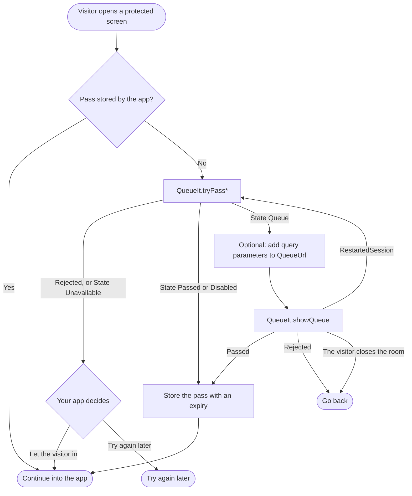

[](https://www.npmjs.com/package/react-native-queue-it)

# react-native-queue-it

React Native Module for integrating Queue-it's virtual waiting room into React Native apps.

Upgrading? See the [upgrade guide](https://github.com/queueit/react-native-queue-it/blob/master/documentation/UPGRADING.md) for what is new and what differs on Android.

## Sample app

Three sample apps are available to try out the library:

- [`exampleApp`](https://github.com/queueit/react-native-queue-it/tree/master/exampleApp): bare React Native
- [`exampleOldArchApp`](https://github.com/queueit/react-native-queue-it/tree/master/exampleOldArchApp): bare React Native 0.81 on the older architecture
- [`example-expo-app`](https://github.com/queueit/react-native-queue-it/tree/master/example-expo-app): Expo (managed)

## Installation

Before starting please download the whitepaper **Mobile App Integration** from the Go Queue-it Platform. This whitepaper contains the needed information to perform a successful integration.

Using npm you can install the module:

```sh
npm install --save react-native-queue-it
#On iOS
cd ios && pod install
```

On iOS, iOS 15 or later is required.

On Android, the library automatically registers the required `QueueActivity` — no manual `AndroidManifest.xml` changes are needed.

### Expo

The library works in a managed Expo project with no extra setup. The only exception is `android:allowBackup`: the Queue-it android SDK uses `allowBackup="true"`, so if your app sets `android.allowBackup` to `false` in `app.json` the Android manifest merge fails. To keep `false`, add a config plugin so your app's value wins the merge.

Create `plugins/withQueueItAllowBackup.js`:

```js
const {
  withAndroidManifest,
  createRunOncePlugin,
} = require('expo/config-plugins');

// Makes the app's android:allowBackup value win the manifest merge.
const withQueueItAllowBackup = (config) =>
  withAndroidManifest(config, (config) => {
    const app = config.modResults?.manifest?.application?.[0];
    if (!app) return config;
    app.$ = app.$ || {};
    const existing = app.$['tools:replace'];
    app.$['tools:replace'] = existing
      ? `${existing},android:allowBackup`
      : 'android:allowBackup';
    return config;
  });

const pkg = require('react-native-queue-it/package.json');

module.exports = createRunOncePlugin(
  withQueueItAllowBackup,
  pkg.name,
  pkg.version
);
```

Register it and regenerate the native project:

```json
{ "expo": { "plugins": ["./plugins/withQueueItAllowBackup"] } }
```

```sh
npx expo prebuild --clean
```

> Bare React Native apps can instead add `tools:replace="android:allowBackup"` to the `<application>` element in `android/app/src/main/AndroidManifest.xml`.

## Usage

The recommended integration has two steps. First `QueueIt.tryPass` (or `QueueIt.tryPassWithEnqueueKey` / `QueueIt.tryPassWithEnqueueToken`) checks whether the visitor can pass, without showing anything. When the `State` of the result is `Queue`, your app calls `QueueIt.showQueue(result)` to show the waiting room and await the visitor's turn. The same code runs on iPhone and Android.



When the visitor closes the waiting room, your app gets `webViewClosed` (the page's close link, both phones) or, on iPhone only, `userExited` (the page's exit link). `showQueue` does not settle then, so your app must go back from those events, as the [Example](#example) does.

On iPhone the waiting room is shown full screen and cannot be swiped away, so a visitor leaves through the page's own links. Starting a new run there (`run`, `runWithEnqueueToken`, `runWithEnqueueKey` or `showQueue`) while an earlier room is open or still starting closes that room, sends no event for it, and leaves the earlier call unsettled.

### Checking for a pass

```tsx
import { QueueIt } from 'react-native-queue-it';
import type { QueueItRunOptions } from 'react-native-queue-it';

const options: QueueItRunOptions = { waitingRoomDomain: undefined };

const check = await QueueIt.tryPass(
  'myCustomer',
  'myEvent',
  undefined, // layoutName
  undefined, // language
  options
);
const checkWithKey = await QueueIt.tryPassWithEnqueueKey(
  'myCustomer',
  'myEvent',
  'myKey',
  undefined,
  undefined,
  options
);
const checkWithToken = await QueueIt.tryPassWithEnqueueToken(
  'myCustomer',
  'myEvent',
  'myToken',
  undefined,
  undefined,
  options
);
```

The arguments are the customer id, the event or alias id, the enqueue key or token (only for the two calls that take one), an optional layout name, an optional language and an optional options object. An empty enqueue key or token throws an `Error` before anything is called.

The result is a `QueueItTryPassResult`:

| Field | Meaning |
| --- | --- |
| `State` | A `TryPassState`: `Passed`, `Disabled`, `Unavailable` or `Queue`. |
| `RedirectType` | What Queue-it answered: `queue`, `safetyNet`, `afterEvent`, `disabled`, `directLink`, `idle` or `unknown`, the last for an answer this library does not list. |
| `QueueITToken` | The token for this session. Empty when `State` is `Unavailable` or `Queue`. |
| `QueueUrl` | The address of the waiting room, used when `State` is `Queue`. |
| `TargetUrl` | The address the visitor wanted to reach. |
| `UrlTTLInMinutes` | How long `QueueUrl` stays valid. |
| `ErrorCode` | Set only when `State` is `Unavailable` because the phone has no connection (iPhone): `NO_CONNECTION`. |
| `CustomerId`, `EventOrAliasId` | The values the check was made with. `showQueue` reads them. |
| `WaitingRoomDomain`, `QueuePathPrefix` | The options the check was made with, when set. `showQueue` reads them. |

The `State` comes from the `RedirectType`, and for `queue` and `unknown` also from whether a `QueueITToken` came with it:

| `RedirectType` | `State` |
| --- | --- |
| `safetyNet` | `Passed` |
| `directLink` | `Passed` |
| `disabled` | `Disabled` |
| `afterEvent` | `Disabled` |
| `idle` | `Disabled` |
| `queue` | `Passed` with a `QueueITToken`, otherwise `Queue` |
| `unknown` | `Passed` with a `QueueITToken`, otherwise `Queue` |

A `directLink` pass is `Passed` on both iPhone and Android. A redirect type this library does not list is reported as `unknown`: `Passed` when the phone's SDK gave a token, since a visitor who has passed is never sent to a waiting room, otherwise `Queue`. A `queue` answer with a token means the visitor already waited and was let through. The pass check shows nothing, so your app can make it before its first screen exists, on both phones.

When the phone has no connection, the two phones differ:

- Android rejects, with `userInfo.errorCode` set to `NO_CONNECTION`.
- iPhone resolves with `State` `Unavailable` and `ErrorCode` `NO_CONNECTION`, on every call in an app session.

When Queue-it itself has an outage, both phones resolve with `State` `Unavailable` and no `ErrorCode`.

### Showing the waiting room

```tsx
import { QueueIt } from 'react-native-queue-it';
import type { QueueItTryPassResult } from 'react-native-queue-it';

declare const check: QueueItTryPassResult;

const result = await QueueIt.showQueue(check);
```

`showQueue` resolves an `EnqueueResult` once the visitor is done in the waiting room:

- `Passed`, with the `QueueITToken` for the session.
- `RestartedSession`, when the visitor restarted the session. Check for a pass again.

When the `State` of the result you pass in is not `Queue`, `showQueue` returns it at once as an `EnqueueResult`, without showing anything. It rejects when `QueueUrl` is empty, and with the errors listed under [Errors](#errors). It sends the same [events](#events) as the one-step flow.

### Example

One async function that runs on both iPhone and Android. It checks for a pass, shows the waiting room when needed, and handles every `TryPassState` and `EnqueueResultState`.

```tsx
import {
  QueueIt,
  EnqueueResultState,
  TryPassState,
} from 'react-native-queue-it';
import type { EnqueueResult, QueueItRunOptions } from 'react-native-queue-it';

// Your app's own helpers.
declare function hasStoredPass(): Promise<boolean>;
declare function storePass(token: string): Promise<void>;
declare function continueIntoApp(): void;
declare function letVisitorInOrTryLater(): void;
declare function goBack(): void;

const customerId = 'myCustomer';
const eventOrAlias = 'myEvent';
const options: QueueItRunOptions = {
  // Optional: your own waiting-room domain, for example 'queue.example.com'.
  waitingRoomDomain: undefined,
};

async function enterProtectedArea(): Promise<void> {
  if (await hasStoredPass()) {
    return continueIntoApp();
  }
  try {
    const check = await QueueIt.tryPass(
      customerId,
      eventOrAlias,
      undefined,
      undefined,
      options
    );
    switch (check.State) {
      case TryPassState.Passed:
      case TryPassState.Disabled:
        await storePass(check.QueueITToken);
        return continueIntoApp();
      case TryPassState.Unavailable:
        // No connection on iPhone (ErrorCode NO_CONNECTION), or a Queue-it outage.
        return letVisitorInOrTryLater();
      case TryPassState.Queue:
        break;
    }

    const subscriptions: { remove: () => void }[] = [];
    const removeSubscriptions = () =>
      subscriptions.forEach((subscription) => subscription.remove());
    // Closing the waiting room never settles showQueue, so go back from these events.
    // The removal is deferred because removing a listener while its event is sent can crash.
    const leave = () => {
      setTimeout(removeSubscriptions, 0);
      goBack();
    };
    subscriptions.push(QueueIt.on('webViewClosed', leave));
    if (QueueIt.isEventAvailable('userExited')) {
      // userExited is iPhone only.
      subscriptions.push(QueueIt.on('userExited', leave));
    }
    let result: EnqueueResult;
    try {
      result = await QueueIt.showQueue(check);
    } catch (e) {
      console.log(`showQueue failed: ${e}`);
      return goBack();
    } finally {
      removeSubscriptions();
    }
    switch (result.State) {
      case EnqueueResultState.Passed:
      case EnqueueResultState.Disabled:
        await storePass(result.QueueITToken);
        return continueIntoApp();
      case EnqueueResultState.Unavailable:
        return letVisitorInOrTryLater();
      case EnqueueResultState.RestartedSession:
        return enterProtectedArea();
    }
  } catch (e) {
    const userInfo = (e as { userInfo?: { errorCode?: string } }).userInfo;
    console.log(`error: ${e}, errorCode: ${userInfo?.errorCode}`);
    // No connection on Android rejects with NO_CONNECTION. Treat it like Unavailable.
    return letVisitorInOrTryLater();
  }
}
```

### Changing the waiting-room address before showing it

Your app may only add query parameters to `QueueUrl`. The scheme, host and path stay as Queue-it built them, and query parameters that are already there, such as `code`, are left alone. The SDK recognises waiting-room pages, and the moment the visitor passes, by the host and path of the address, so a changed host or path breaks both.

```tsx
import { QueueIt } from 'react-native-queue-it';

const withQueryAdded = (queueUrl: string, query: string) => {
  if (/[?&]$/.test(queueUrl)) {
    return `${queueUrl}${query}`;
  }
  return queueUrl.includes('?')
    ? `${queueUrl}&${query}`
    : `${queueUrl}?${query}`;
};

const check = await QueueIt.tryPass('myCustomer', 'myEvent');
const changed = {
  ...check,
  QueueUrl: withQueryAdded(check.QueueUrl, 'source=newsletter'),
};
await QueueIt.showQueue(changed);
```

### Invite-only waiting rooms

To let a visitor into an invite-only waiting room, pass `inviteCode` in the options of `tryPass*` or `run*`. The SDK adds it to the waiting-room address as the `code` query parameter, unless the address already has one. A blank code is ignored. It works with or without `waitingRoomDomain`.

```tsx
import { QueueIt } from 'react-native-queue-it';

const check = await QueueIt.tryPass(
  'myCustomer',
  'myEvent',
  undefined,
  undefined,
  { waitingRoomDomain: undefined, inviteCode: 'myInviteCode' }
);
```

In the pass-check flow the code travels inside `QueueUrl`, so your app must not remove it, and must not add its own `code`.

### Using your own waiting-room domain

To show the waiting room on your own domain, pass `waitingRoomDomain`, and optionally `queuePathPrefix`, in the options argument of `tryPass*` or `run*`:

```tsx
import { QueueIt } from 'react-native-queue-it';

const check = await QueueIt.tryPass(
  'myCustomer',
  'myEvent',
  undefined,
  undefined,
  {
    // Your own waiting-room domain, as a bare host without a scheme.
    waitingRoomDomain: 'queue.example.com',
    // The path on that domain where the waiting room is served.
    queuePathPrefix: 'waitingroom',
  }
);
```

Leave `waitingRoomDomain` unset to use `<customerId>.queue-it.net`. `queuePathPrefix` is ignored unless `waitingRoomDomain` is set. `showQueue` takes both from the result of the pass check, so you do not pass them again.

### Remembering that the visitor has passed

As the app developer you must manage the state (whether the visitor has passed) inside your app's storage. After `tryPass*` or `showQueue` reports `Passed`, the app must remember the token, possibly with a date/time expiration. When the visitor goes to another page/screen, you check your stored pass, and only check for a pass with `tryPass*` when there is none. When the visitor clicks back, the same check needs to be done.

On iPhone and Android, Queue-it also remembers the visitor's place for the phone, across runs and app restarts. A new run started soon after a pass can reuse that place. After the room's limit of passes for one place, the page shows "Rejected queue number". So keep the visitor's pass for the session, and do not run again right after a pass.

### One-step flow

`QueueIt.run`, `QueueIt.runWithEnqueueKey` and `QueueIt.runWithEnqueueToken` still work. They take the same options and resolve an `EnqueueResult`. See the [upgrade guide](https://github.com/queueit/react-native-queue-it/blob/master/documentation/UPGRADING.md) for what changed on iPhone.

```tsx
import { QueueIt } from 'react-native-queue-it';

const result = await QueueIt.run('myCustomer', 'myEvent');
```

On Android, a `directLink` pass still shows the waiting room in these calls until a future Android SDK release, while the pass check reports `Passed`. On iPhone they report `Passed`.

With no connection on iPhone, these calls resolve `Unavailable` with `ErrorCode` `NO_CONNECTION` before the waiting room opens, on every call in an app session, and reject after it. When Queue-it has an outage they resolve `Unavailable` on both phones.

### Events

You can receive events from this library by subscribing to it:

```tsx
import { QueueIt } from 'react-native-queue-it';

QueueIt.once('openingQueueView', () => console.log('opening queue page..'));
//Or
const listener = QueueIt.on('openingQueueView', () =>
  console.log('opening queue page..')
);
// ...
listener.remove();
```

These are the events that are emitted:

| Event | When | Listener details | Android |
| --- | --- | --- | --- |
| `openingQueueView` | The waiting room is going to be shown. | None. | Yes |
| `webViewClosed` | The visitor clicks the `queueit://close` link of the waiting-room page. | None. | Yes |
| `userExited` | The visitor leaves the waiting room through the page's exit link. | None. | No, iPhone only |
| `queueUrlChanged` | The address of the waiting-room page changes. | `{ url: string }`, the new address as the phone's SDK reports it. | Yes |

The events are sent during `showQueue` and during the one-step calls. `queueUrlChanged` fires on every queue-page navigation on Android, but on iPhone only when the SDK rewrites the address. `webViewClosed` and `userExited` do not end the call.

A listener receives the details of the notification as its argument, so `() => void` listeners keep working.

```tsx
import { QueueIt } from 'react-native-queue-it';

QueueIt.on('queueUrlChanged', (details) =>
  console.log(`queue page: ${details?.url}`)
);
```

To ask whether an event is available on the phone your app runs on, use `QueueIt.isEventAvailable(event)`. It returns `false` for `userExited` on Android and for any name that is not one of the four above, and `true` otherwise.

```tsx
import { QueueIt } from 'react-native-queue-it';

if (QueueIt.isEventAvailable('userExited')) {
  QueueIt.on('userExited', () =>
    console.log('the visitor left through the exit link')
  );
}
```

In a development build, subscribing to `userExited` on Android with `on` or `once` logs one warning per app session.

### Errors

A failure reaches your app in one of three ways:

- A native rejection, with the code `error`, a message, and `userInfo.errorCode` when the SDK gave one.
- An `Error` thrown in JavaScript, with only a message and no `code` or `userInfo`.
- An `Unavailable` result. On iPhone with no connection it has `ErrorCode` `NO_CONNECTION`. When Queue-it is unavailable it has no `ErrorCode`, on both phones. For your app it means the `Unavailable` choice in the chart above: let the visitor in, or try again later.

`userInfo.errorCode` is one of these codes:

| Code | What it means for the app | Android | iPhone |
| --- | --- | --- | --- |
| `NO_CONNECTION` | The phone has no connection. | `tryPass*`, `run*` | `run*` after the waiting room opens, and `showQueue` (the first page fails to load with no connection) |
| `INVALID_RESPONSE` | Queue-it answered with HTTP 4xx, most likely a misconfiguration of the queue settings: an invalid customer id, event alias id or cname setting (Go Queue-it portal, event settings). On iPhone `showQueue` also uses it for an address that cannot be read, and `runWithEnqueueToken` and `runWithEnqueueKey` use it for an empty value, which rejects with code `error` and the message "EnqueueToken cannot be empty" or "EnqueueKey cannot be empty". | HTTP 4xx on `tryPass*`, `run*` | HTTP 4xx on `tryPass*`, `run*`; a bad address in `showQueue`; an empty value in `runWithEnqueueToken` and `runWithEnqueueKey` |
| `API_ERROR` | A page of the waiting room failed to load, for example because the connection was lost. | Never | A page that fails to load in the waiting room |
| `DEVICE_ID_ERROR` | The SDK could not get a device identifier. | Never | `tryPass*`, `run*`, `showQueue` |
| `SSL_ERROR` | The SSL connection failed, for example a custom waiting-room domain with an invalid certificate. | `run*`, `showQueue` (the only error the Android waiting room reports) | `run*`, `showQueue` |
| `QUEUEIT_UNAVAILABLE` | Queue-it is unavailable. | Never surfaced | Never surfaced |

This library raises these errors itself, and they have no `errorCode`:

| Error | Phones | Calls | How it arrives |
| --- | --- | --- | --- |
| `QueueUrl cannot be empty` | Both | `showQueue` | Thrown in JavaScript |
| `EnqueueToken cannot be empty` | Both | `tryPassWithEnqueueToken` | Thrown in JavaScript |
| `EnqueueKey cannot be empty` | Both | `tryPassWithEnqueueKey` | Thrown in JavaScript |
| No activity to show the waiting room on | Android | `run*`, `showQueue` | Native rejection with code `error` |
| An empty customer id or event id | Android | `tryPass*`, `run*` | Native rejection with code `error` |
| No screen to show the waiting room on | iPhone | `run*`, `showQueue` | Native rejection with code `error` |
| The pass check ended without a result | Both | `tryPass*` | Native rejection with code `error` on iPhone; thrown in JavaScript on Android |

On iPhone with no connection, `tryPass*` resolves `Unavailable` with `ErrorCode` `NO_CONNECTION`, and `run*` does the same before the waiting room opens. `ErrorCode` is unset in every other result.

After the waiting room has opened, an SSL error rejects `showQueue` and the `run*` calls on both Android and iPhone. On iPhone, a page of the waiting room that fails to load, for example because the connection was lost, also rejects `showQueue` and the `run*` calls. On Android such errors are not reported, and the call stays open.

## License

MIT
